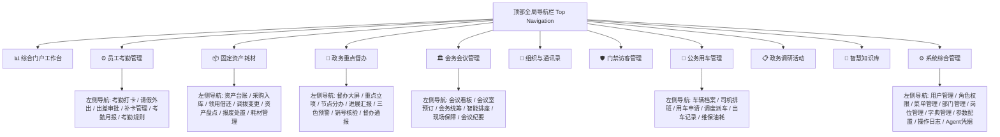
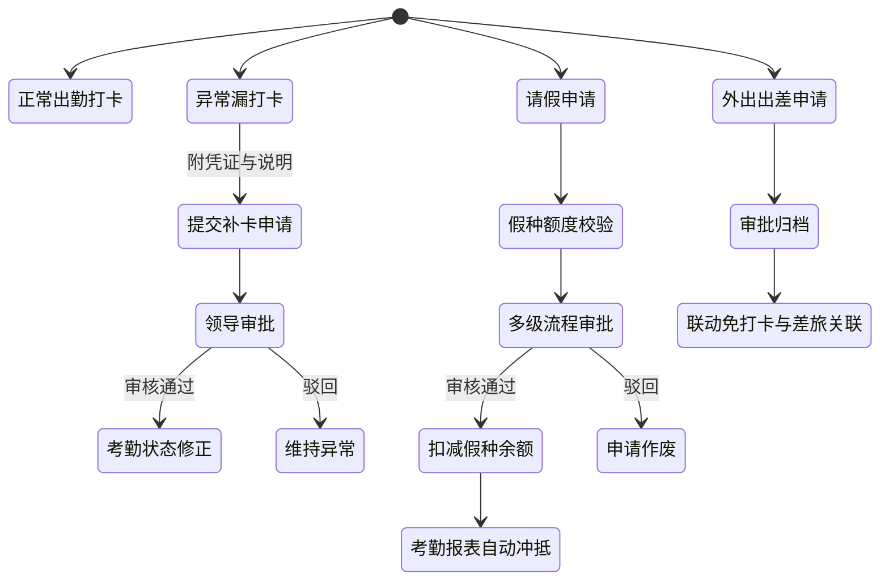
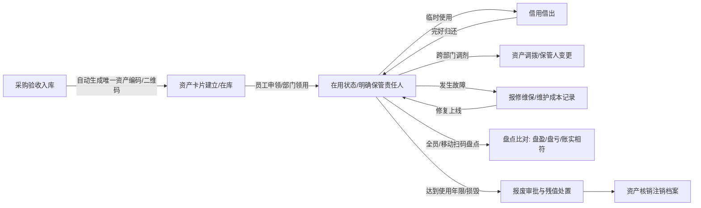
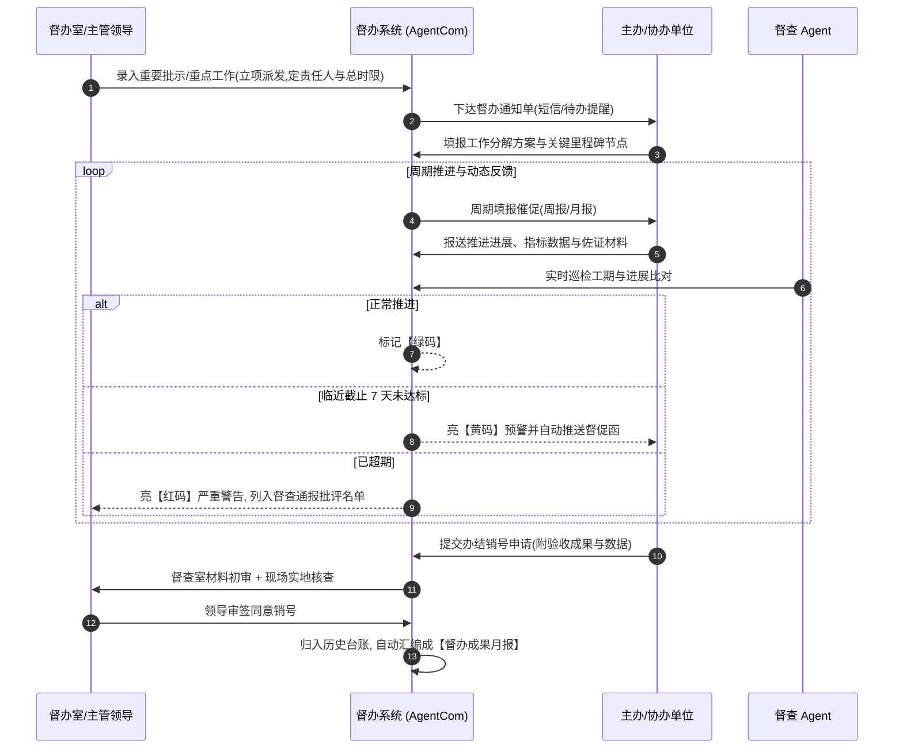
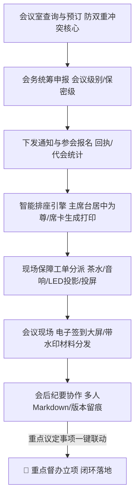
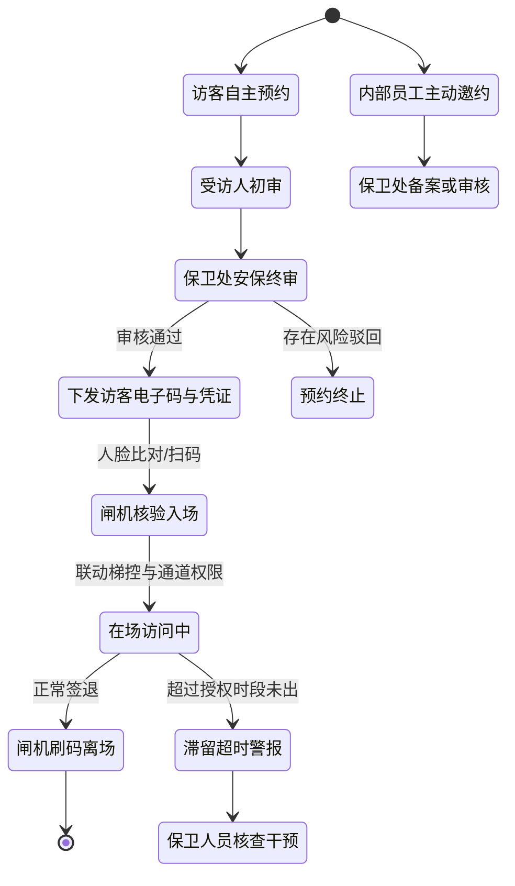
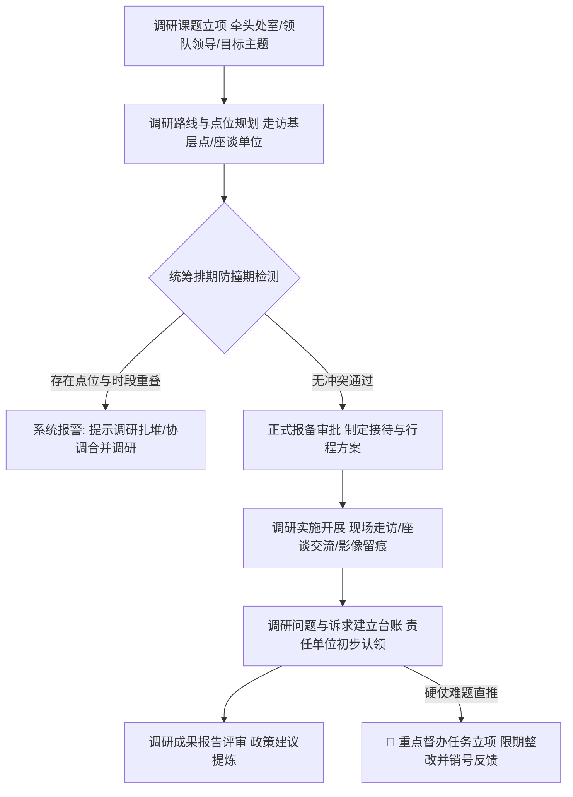
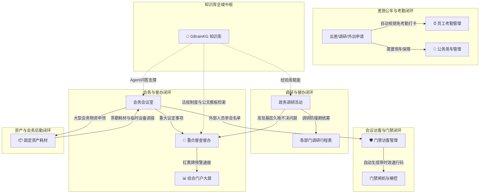
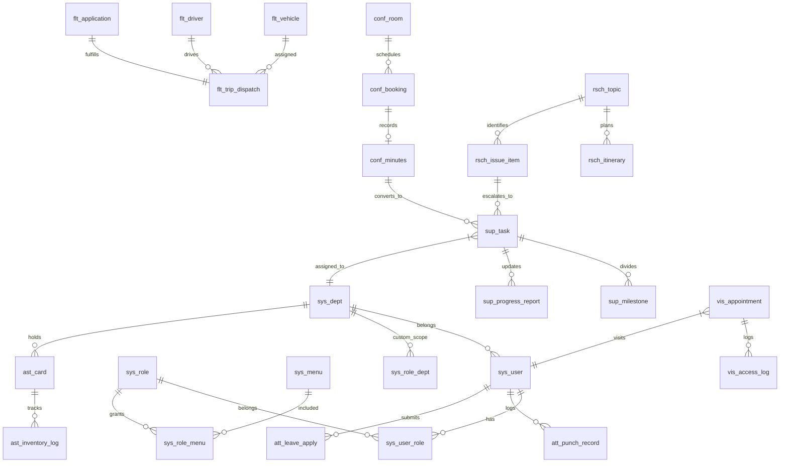

# AgentCom 企业与政务协同办公与智慧管理平台
## 需求规格说明书 (PRD) 与竞品调研全景设计方案

> **文档版本**：v1.0.0  
> **编写日期**：2026-10-01  
> **系统定位**：面向政企组织的高效协同办公、资产治理、政务督办、后勤保障综合管理平台，原生支持 **Web UI（顶部大类+左侧功能二级导航）**、**OpenAPI 规范** 与 **MCP (Model Context Protocol 2.2.0)** 双协议，供人类员工与 AI Agent 高度协同闭环操作。  
> **设计基线**：深度复用若依（RuoYi）RBAC 权限体系与数据范围隔离机制；无缝继承并升级 `/home/scottsun/meetmanager` 会议室引擎；深度直链融合 `/home/scottsun/gbrainkg` 智能图谱知识库。

---

## 目录
1. [项目背景与设计原则](#1-项目背景与设计原则)
2. [竞品调研与政企核心诉求剖析](#2-竞品调研与政企核心诉求剖析)
3. [整体架构与交互体系设计](#3-整体架构与交互体系设计)
   - 3.1 导航体系架构（顶部大类 + 左侧功能树）
   - 3.2 若依 (RuoYi) RBAC 权限与数据隔离模型
   - 3.3 OpenAPI 与 MCP Agent 双协议集成体系
4. [十大核心业务大类全闭环功能规格](#4-十大核心业务大类全闭环功能规格)
   - 4.1 员工考勤管理大类（考勤、请假、外出、出差、补卡、月结）
   - 4.2 固定资产与耗材大类（一物一码、采购入库、领用归还、盘点、折旧报废）
   - 4.3 政务与重点工作督查督办大类（立项交办、节点分解、三色预警、现场核验销号、通报简报）
   - 4.4 会务与会议室管理大类（继承MeetManager + 扩充政务排座、会务保障、席卡、决议转督办）
   - 4.5 组织架构与通讯录大类（多级组织树、高层隐私脱敏、外联单位、专家智库、安全水印）
   - 4.6 门禁访客管理大类（预约邀约、双级审批、人脸/二维码核验、闸机梯控、滞留告警）
   - 4.7 公务用车管理大类（一车一档、中央八项规定合规、三级审批、调度派车、维保油耗审计）
   - 4.8 政务调研活动管理大类（课题立项、防撞期统筹、动线接待、问题台账、成果转督办）
   - 4.9 智能知识库大类（GBrainKG直链集成、图谱切片、政企文档库、Agent知识召回）
   - 4.10 综合系统管理大类（若依RBAC核心、岗位字典、参数配置、操作审计、Agent凭据管理）
5. [跨模块业务闭环与智能协同网络](#5-跨模块业务闭环与智能协同网络)
6. [Agent MCP 工具链与 OpenAPI 协议清单](#6-agent-mcp-工具链与-openapi-协议清单)
7. [数据库模型与核心实体设计 (E-R Schema)](#7-数据库模型与核心实体设计-e-r-schema)
8. [非功能性与信创安全规范](#8-非功能性与信创安全规范)

---

## 1. 项目背景与设计原则

随着各级党政机关数字化转型深化与大型企事业单位规范化治理升级，日常政务办公与后勤运营呈现出**业务链条长、审批层级严、跨部门协同频度高、合规审计要求高**等鲜明特点。与此同时，大模型与 AI Agent 技术正在从单一问答走向复杂任务的自主规划与执行。

本项目 `AgentCom` 旨在打造一套既符合中国政企严格制度标准（如中央八项规定公车制度、国有资产全生命周期管理办法、党政机关督查工作条例、大兴调查研究工作方案），又天然具备 **AI Agent 自主感知、推理与动作能力 (Agent-Ready)** 的一体化协同办公平台。

### 核心设计原则
1. **全链路闭环 (Closed-loop by Design)**：所有业务模块拒绝“记流水账”式的死数据，每个业务对象均具备从“立项/申请 $\rightarrow$ 审核 $\rightarrow$ 派发/执行 $\rightarrow$ 异常催办/调优 $\rightarrow$ 归档/销号/评价”的完整状态机。
2. **若依 RBAC 深度复用 (Standard RBAC & Data Scopes)**：完整复用并严格落实若依经典的“用户-角色-岗位-菜单/按钮-部门”五维控制模型，提供从 `全部数据`、`自定义部门`、`本部门及以下`、`本部门` 到 `仅本人` 的 5 级行级数据权限隔离。
3. **双层导航空间 (Top-Category & Left-Function Menu)**：顶部水平导航切换各大业务域（大类），左侧垂直导航展示该大类下的目录（M）、功能菜单（C）与按钮权限（F），兼顾大系统的信息层级与日常操作的纯粹性。
4. **人类与 Agent 双模驱动 (Human & Agent Dual-Run)**：人类用户通过高保真 Web 界面操作；AI Agent 通过 OpenAPI 与 MCP (Model Context Protocol 2.2.0) 获取结构化数据、发起申请、代办审批、催办督办、智能排座与数据提炼。
5. **资产沉淀复用**：会议室排期调度全面继承 `/home/scottsun/meetmanager` 的高并发防双重冲突能力并进行会务扩充；知识库大类直接单点打通并深度融合 `/home/scottsun/gbrainkg` 图谱与语义知识中枢。

---

## 2. 竞品调研与政企核心诉求剖析

我们对国内主流协同办公与政务专项软件进行了深度横向调研，涵盖：
- **政企协同办公标杆**：泛微 (Weaver e-cology / e-nation)、致远互联 (Seeyon COP / G6 信创政务系统)、蓝凌 (Landray MK 数字化工作平台)
- **移动与协同互联网标杆**：钉钉 (DingTalk / 浙政钉)、企业微信 (WeCom / 政务微信)、飞书 (Feishu / 飞书深研)
- **垂直专项标杆**：易点易动 (固定资产与耗材 EAM)、政务督查督办专管系统、公务用车全生命周期管控平台

### 2.1 竞品横向对比矩阵

| 业务大类 | 传统 OA（泛微/致远/蓝凌） | 移动协同（钉钉/企微/飞书） | 垂类系统（易点易动/公车专管） | **AgentCom 创新突破与闭环优势** |
|:---|:---|:---|:---|:---|
| **考勤管理** | 流程强大但移动打卡与弹性规则配置繁重，报表汇总计算较慢。 | 移动定位/人脸打卡极佳，但政企公差审批与台账核算相对标准化，缺乏定制销假机制。 | 专注于工时统计，与考勤流程脱节。 | **打卡+请休假+外出/出差+补卡+自动抵扣年假/调休+月度工时台账**全闭环；Agent支持自然语言代提交与核验。 |
| **资产耗材** | 偏重流程审批，往往无条码/RFID一物一码动态追踪，账实脱节明显。 | 审批流便捷，但缺乏国标资产分类、原值/折旧测算、批量盘点差异分析与报废处置。 | 功能专业完整，但作为独立系统形成信息孤岛，无法联动员工离职交接与会务物资领用。 | **固定资产一物一码 + 耗材安全库存预警 + 领用/借还/调拨/盘点/折旧/报废全生命周期**；与离职交接、会议室保障紧密联动。 |
| **督办任务** | 功能分散在任务与公文中，缺乏两办督查专用编号、三色灯预警、督办月报自动生成。 | 多为普通待办与日程提醒，缺乏针对党政领导批示、重点工程、现场销号的督办规范。 | 专管系统流程严格，但UI老旧，与其他业务不通，无法由会议决议/调研一键转立项。 | **严格遵循党政督查工作规范**：立项分办、阶段里程碑甘特图、蓝黄红三色预警、现场销号核验、周月报简报自动汇编；**支持会议决议与调研问题一键转办**。 |
| **会务会议室** | 涵盖排座和通知，但并发预订防冲突能力弱（数据库层无排斥约束），纪要与督办割裂。 | 预订体验好，但无法满足政务大型会务“主席台规则排座、席卡打印、茶歇音视频派工、带水印加密资料”等严谨需求。 | 独立会议屏或预订机，偏硬件管理。 | **直接复用 meetmanager PostgreSQL tsrange GiST 并发零冲突防双重预订**；全面扩充**政务智能排座引擎、席卡生成、会务保障派工、决议一键转督办**。 |
| **组织通讯录** | 树形组织完善，但涉敏信息缺乏动态权限掩码，外部联络单位分散在个人手中。 | 组织树易用，但政府机关多重兼职、虚拟课题组、高干防打扰机制支持有限。 | 仅维护简单联系人，无组织编制关联。 | **无限级政企架构树 + 领导号码脱敏掩码 + 政企外部联络单位与专家智库 + 防截屏数字水印 + Agent智能找人**。 |
| **门禁访客** | 内部申请流成熟，但与线下闸机、梯控、人脸核验联动脱节，访客滞留无告警。 | 访客扫码体验佳，但政企涉密大院的“两级审批（受访人+保卫处）”及黑名单阻断能力较弱。 | 纯安防硬件端，缺乏业务邀约与会议联动。 | **访客自主预约 + 内部员工主动邀约 + 两级安防审批 + 电子通行码/人脸核验 + 滞留超时自动告警 + VIP绿色通道**。 |
| **公务用车** | 偏审批单据，无法做到“一车一档”与精准路线、实际归队里程、定点油耗与八项规定合规审计。 | 偏向打车企业报销，无法管理自有公车编制、司机排班、车队调度。 | 专业调度强，但与出差审批、调研活动脱钩。 | **严格落实公车改革与八项规定**：编制台账、用车三级审批、顺路拼车智能调度、电子派车单、回程里程/油票核销、年检维保预警；**与调研活动无缝协同**。 |
| **调研活动** | 极度匮乏，通常沦为普通日程或公文流转，无法解决“调研扎堆、同一路线撞车”难题。 | 无专项调研管理，仅有群聊与共享文档。 | 市面几乎无成熟轻量级产品，仅有个别大型定制政务平台。 | **大兴调查研究专版**：课题库与计划统筹、**防撞期防扎堆冲突检测**、动线与接待方案、现场问题清单台账、**问题一键转办督办任务**。 |
| **知识库** | 文档目录树为主，缺乏基于实体关系的图谱切片与深度向量问答。 | 知识库侧重富文本协作（飞书知识库），缺乏企业级私有化知识图谱与Agent原生工具。 | 纯RAG检索或向量库，无业务管理入口。 | **直接链接打通 `/home/scottsun/gbrainkg`**，无缝复用成熟的知识图谱抽取、向量检索与 LLM Wiki 引擎，并向全系统 Agent 赋能。 |
| **系统与权限** | 权限配置繁琐，角色模型自定义成本高。 | 偏简单企业角色，无法支持精细到字段与数据行级的范围隔离。 | 系统各异，难以统一账号。 | **原汁原味若依（RuoYi）RBAC 架构**：User-Role-Dept-Post-Menu-DataScope（1~5级隔离）+ 统一字典 + 操作日志 + Agent凭据密钥发放体系。 |

---

## 3. 整体架构与交互体系设计

### 3.1 导航体系架构（顶部大类 + 左侧功能树）

系统摒弃传统扁平长侧栏导致的“菜单过深、难以查找”缺陷，采用**“顶部大类（顶级业务域）+ 左侧功能树（二级分类/具体功能/工作台）”**的双层空间导航规范：

- **顶部导航**：固定于浏览器最上方（高度 56px），展示组织 Logo、平台名称、各大类 Tab 按钮、全局搜索快捷键（`Cmd+K`）、待办角标、系统通知、当前登录用户头像与快捷退出。
- **左侧导航**：点击顶部不同大类时，左侧栏以平滑动画无缝切换对应的二级与三级菜单。支持根据当前用户的若依 RBAC 角色权限动态裁剪。

---

### 3.2 若依 (RuoYi) RBAC 权限与数据隔离模型

完全沿用若依经典权限控制模型，实现**功能权限（Menu/Button）**与**数据权限（DataScope）**的双重强约束。

#### 1. 核心实体映射
- **`sys_user`**：系统用户表，存储用户账号、姓名、密码哈希（Argon2id/BCrypt）、部门归属、岗位、手机号、状态。
- **`sys_role`**：角色表，包含角色标识（`roleKey` 如 `admin`, `dept_leader`, `staff`, `clerk`）、数据权限范围（`dataScope`）。
- **`sys_menu`**：菜单与操作权限表，划分为三类：
  - `M`（目录）：顶级大类下的二级分组。
  - `C`（菜单）：实际页面路由。
  - `F`（按钮/接口权限）：如 `supervision:task:add`, `attendance:leave:audit`, `assets:item:scrap`。
- **`sys_dept`**：部门组织树，支持祖级列表（`ancestors` 如 `0,100,101`），便于 SQL 级层级检索。
- **`sys_post`**：岗位定义，如局领导、处长、科长、督办专员、资产管理员、车队调度员、保卫干事。

#### 2. 数据权限范围（DataScope 1~5 级隔离标准）
服务端 API 在执行 SQL 查询时，自动基于当前用户的最高角色数据范围注入过滤条件：
- `1 - 全部数据权限`：无附加过滤条件（超级管理员、分管领导）。
- `2 - 自定义数据权限`：跨部门专项小组或督办专项联合工作组（基于 `sys_role_dept` 映射关联表过滤）。
- `3 - 本部门数据权限`：`dept_id = current_user.dept_id`（部门负责人）。
- `4 - 本部门及以下数据权限`：`dept_id IN (SELECT dept_id FROM sys_dept WHERE ancestors LIKE '%,current_dept_id,%' OR dept_id = current_dept_id)`（分管局长、大处室处长）。
- `5 - 仅本人数据权限`：`create_by = current_user.user_id`（普通办事员、普通员工）。

---

### 3.3 OpenAPI 与 MCP Agent 双协议集成体系

平台继承并在架构上提升 `/home/scottsun/meetmanager` 的 Agent 接入规范：
1. **OpenAPI 3.1 规范**：提供全量 RESTful 端点，自动生成交互式 Swagger/ReDoc 文档，供外部系统及微服务调度。
2. **MCP (Model Context Protocol 2.2.0)**：
   - 支持 **Streamable HTTP** (`POST /mcp`) 与传统 **SSE** (`GET /sse`) 两种传输通道。
   - 鉴权模式：支持管理员在【系统管理 $\rightarrow$ Agent 凭据】中颁发 `App ID` 与 `App Secret`，支持细粒度权限作用域（Scopes，如 `attendance:write`, `supervision:admin`, `fleet:dispatch`）。
   - **Agent 自主协同闭环**：Agent 不仅可进行简单“查阅”，还可自主进行复杂业务闭环。例如：
     - *“检测到下周二上午有省厅调研，请帮我筛选并预订一间20人的多媒体会议室，自动排好座次并向保卫处发起5位专家的门禁要约。”*
     - Agent 通过调用 MCP 工具链中的 `meeting_room_book` $\rightarrow$ `meeting_seating_layout` $\rightarrow$ `visitor_create_invitation` 一气呵成。

---

## 4. 十大核心业务大类全闭环功能规格

---

### 4.1 员工考勤管理大类 (Attendance & Leave)

#### 1. 业务痛点与闭环设计
政企考勤具备**弹性打卡与硬性纪律并存、请假类型多样（年假、调休假、病假、事假、婚产假、育儿假、探亲假）、外出公干频繁、工时月末严格核算**的特点。系统必须实现“请假审批通过后，考勤报表自动消除异常”、“出差审批通过后，免除当日打卡考勤”的动态闭环。

#### 2. 左侧菜单与功能模块
1. **考勤工作台** (`/attendance/dashboard`)：个人当日打卡状态、本月出勤率、请假/补卡快捷入口、考勤日历视图（迟到/早退/旷工彩色标记）。
2. **打卡记录管理** (`/attendance/records`)：GPS/WiFi 打卡明细、外勤现场水印拍照记录、多条件检索与导出。
3. **请假休假中心** (`/attendance/leave`)：
   - 假种配置与额度账户（年休假依法计算、加班兑换调休假流水池）。
   - 请假发起、附件上传（如病假医院证明）、多级审批流。
   - 销假与假条作废反向闭环。
4. **外出与出差报备** (`/attendance/trip`)：外出公干事由、同行人员、出差起止时间与路线规划，审批通过后自动关联免打卡名单。
5. **异常与补卡申请** (`/attendance/remedy`)：漏打卡/机器故障异常补录，支持主管审批并自动修正打卡记录。
6. **月度考勤汇总报表** (`/attendance/monthly-settlement`)：全员出勤天数、迟到早退次数、各类假期扣减工时自动核算，支持 HR 月末一键锁账与导出归档。
7. **班次与考勤组规则** (`/attendance/rules`)：固定班次、排班制、自由工时、打卡地点经纬度与有效半径（米）、公司指定 WiFi BSSID 绑定。

#### 3. Agent & MCP 工具清单
- `attendance_clock_in(user_id, type, location, wifi_mac)`：执行打卡或外勤签到。
- `attendance_query_status(user_id, date)`：查询指定用户出勤明细与打卡异常。
- `attendance_apply_leave(leave_type, start_time, end_time, reason)`：自动核验假期余额并发起请假。
- `attendance_audit_workflow(instance_id, action, comment)`：主管 Agent 代办快速审批。

---

### 4.2 固定资产与耗材大类 (Assets & Consumables)

#### 1. 业务痛点与闭环设计
贯彻落实国有资产和企业固定资产全生命周期管理，解决“账实不符、私自挪用、闲置浪费、资产盘点耗费数周、报废流于形式”等顽疾。低值易耗品（办公耗材）实现“采购 $\rightarrow$ 入库 $\rightarrow$ 安全库存监控 $\rightarrow$ 领用申领 $\rightarrow$ 自动核减”的全过程闭环。

#### 2. 左侧菜单与功能模块
1. **资产全景看板** (`/assets/overview`)：固定资产总值、在用率、闲置率、待维修数、本月折旧额、耗材预警指数。
2. **固定资产台账** (`/assets/ledger`)：一物一码（条形码/二维码/RFID）、资产国标分类、规格型号、原值、净值、存放地点、使用人、所属部门。
3. **入库与建档** (`/assets/inbound`)：采购合同关联、验收单登记、批量导入生成资产卡片并提供一键标签打印。
4. **领用与退库** (`/assets/requisition`)：领用申请、审批派发、领用签字确认；闲置退库验收入库。
5. **借用与归还** (`/assets/borrow`)：借用登记、预计归还时间预警、到期超期短信/邮件催还、归还验视。
6. **资产调拨管理** (`/assets/transfer`)：跨部门、跨项目调剂流转，原责任人与新接收人双方会签确认。
7. **维保与维修** (`/assets/maintenance`)：故障报修、维修单位指派、维修费用登记与累计折损记账。
8. **智能资产盘点** (`/assets/stocktake`)：
   - 盘点任务创建（按部门、按存放地点、按资产分类抽盘或全盘）。
   - 移动端/扫码枪扫码即时核验，自动标记“已盘、未盘、盘盈、盘亏”。
   - 盘点差异报告与审批调账。
9. **折旧与报废处置** (`/assets/depreciation-scrap`)：按月平均年限法自动计提折旧；报废申请、技术鉴定报告上传、国资处置审批流程、残值回收变价登记。
10. **低值办公易耗品** (`/assets/consumables`)：易耗品品类目录、安全库存上下限阈值、低库存自动预警、部门领用配额管理。

#### 3. Agent & MCP 工具清单
- `assets_query_stock(keyword, category_id, status)`：查询资产或耗材在库与借用情况。
- `assets_create_requisition(item_id, count, reason)`：发起领用申请。
- `assets_stocktake_scan(plan_id, asset_code)`：盘点过程实时回传资产条码完成签到。
- `assets_low_stock_reminder()`：巡检低于安全库存的办公耗材并生成补货建议单。

---

### 4.3 政务与重点工作督查督办管理大类 (Supervision & Tasks)

#### 1. 业务痛点与闭环设计
严格对标党政机关《督查工作条例》与重点工作推进机制。彻底杜绝“批示转办无人跟、阶段推进无抓手、临到年底突击补台账”现象。建立“**立项登记 $\rightarrow$ 任务分解（里程碑） $\rightarrow$ 承办反馈 $\rightarrow$ 过程预警（红黄蓝码） $\rightarrow$ 延期重申 $\rightarrow$ 现场/证据核验 $\rightarrow$ 审签销号 $\rightarrow$ 简报通报**”严密闭环。

#### 2. 左侧菜单与功能模块
1. **督办指挥大屏** (`/supervision/dashboard`)：督办事项总数、在办数、按期办结率、红黄蓝预警状态分布、承办部门办结排行榜。
2. **督办立项管理** (`/supervision/standing`)：
   - 督办来源（领导批示、政府工作报告、党委会决议、常务会纪要、人大建议政协提案、应急专项）。
   - 督办编号自动生成、紧急程度（特急、急、常规）、主办处室、协办处室、总办结时限。
3. **任务分解与甘特里程碑** (`/supervision/decomposition`)：承办单位细化阶段性交付物、时间节点里程碑、责任到具体经办人。
4. **进展反馈与台账填报** (`/supervision/reporting`)：定期报送（周报、半月报、月报）、完成百分比、阶段性突破、存在困难与需要协调事项，支持图片及成果公文佐证上传。
5. **动态预警与智能催办** (`/supervision/warning`)：
   - **绿码**（进度正常）、**黄码**（临期7天/节点延滞预警）、**红码**（超期未结高危告警）。
   - 一键下发《督查催办通知单》，支持短信、站内信、Agent 电话语音播报催办。
6. **延期申请与变更审核** (`/supervision/extension`)：因客观政策或不可抗力导致滞后的，须由主办单位发起说明并经督查室和分管领导审批后方可调整工期。
7. **办结销号与现场核验** (`/supervision/closeout`)：提出销号申请 $\rightarrow$ 督查室材料审核 $\rightarrow$ 必要时组织现场实地勘查 $\rightarrow$ 主管领导签批同意销号，完成全链条闭环。
8. **督查简报与考核通报** (`/supervision/bulletin`)：系统自动按周、月、季度将各单位推进情况、红黄牌次数、办结质量一键生成规范格式的《督查通报》（支持 Word/PDF 导出）。

#### 3. Agent & MCP 工具清单
- `supervision_create_item(source, title, lead_dept_id, deadline, priority)`：由领导批示或会议纪要自然语言一键立项。
- `supervision_submit_progress(task_id, milestone_id, progress_pct, details)`：提交里程碑进展汇报。
- `supervision_trigger_auto_urging()`：自动化巡检临期红黄码督办并发送催办通知。
- `supervision_generate_briefing(period_type, date_range)`：大模型自动聚合所有单位进展并提炼生成督查通报简报。

---

### 4.4 会务与会议室管理大类 (Conference & Meeting Affairs)

#### 1. 业务痛点与闭环设计
在 `/home/scottsun/meetmanager` 的坚实基础上，**直接继承**其高并发数据库级防冲突（PostgreSQL `tsrange` + GiST 排除约束）、会议室基础配置、日程甘特图、Markdown 纪要与版本追踪。

**重点深度扩充政企核心会务能力**：大型政务会议往往需要“**会前申报 $\rightarrow$ 参会回执通知 $\rightarrow$ 智能座次排布（主席台与列席） $\rightarrow$ 席卡打印 $\rightarrow$ 现场会务后勤派工（茶水/音视频/LED大屏） $\rightarrow$ 扫码签到 $\rightarrow$ 纪要决议一键转督办**”。

#### 2. 左侧菜单与功能模块
1. **会议大屏与日程看板** (`/conference/schedule`)：完全沿用 meetmanager 经典甘特视图，可视化全单位会议室占用与空闲状态。
2. **会议室维护管理** (`/conference/rooms`)：容纳人数、多媒体设备标签、所属楼宇/层数、审批规则、停用/开放状态。
3. **预订管理与审批** (`/conference/bookings`)：快速预订、Dry-Run 冲突预检、大型重要会议室审批流。
4. **政务会务统筹** (`/conference/affairs`)：会议性质（党组会、常务会、例会、外部研讨会）、会议议程编排、保密级别（涉密/非密）、预算报备。
5. **参会人员与报名回执** (`/conference/attendees`)：下发参会通知、接收在线回执（确认参会/请假说明/指派代会人员）、参会花名册统计。
6. **智能排座与席卡系统** (`/conference/seating`)：
   - 遵循严肃政务座次礼仪：支持“以中为尊”、“前排为尊”、“左为上/右为上”排布规则。
   - 主席台排座、U型会议桌、岛式分组排座可视化拖拽调整。
   - 一键批量生成标准尺寸双面席卡（PDF/高清图片打印）。
7. **会务保障派工** (`/conference/services`)：会务服务工单管理，指派后勤人员完成茶歇备水、调音测试、LED 欢迎横幅投影、空调预开。
8. **电子签到大屏** (`/conference/checkin`)：动态二维码签到、人脸快速核验、现场应到/实到/缺席大屏动态刷新。
9. **会议纪要与行动项** (`/conference/minutes`)：基于 meetmanager 纪要，支持多人协作、自动版本递增、行动项指定。
10. **议定决议转督办** (`/conference/minutes-to-supervision`)：**关键协同接口**，从纪要的 Action Items 中勾选重大事项，一键直推至【政务重点督办】大类生成督办单。

#### 3. Agent & MCP 工具清单
- `meeting_book_room(room_id, start_time, end_time, title, attendees)`：继承原版防冲突预订。
- `meeting_generate_seating(meeting_id, rule_type)`：根据参会干部职级自动计算并排布席位图。
- `meeting_dispatch_service(meeting_id, service_items)`：一键派发音视频与茶歇后勤工单。
- `meeting_convert_to_supervision(minutes_item_id, lead_dept_id, deadline)`：纪要决议一键建立督办任务。

---

### 4.5 组织架构与通讯录管理大类 (Org & Contacts)

#### 1. 业务痛点与闭环设计
政企单位组织关系复杂，存在“直属行政机构、下设事业单位、派出机构、挂靠协会、虚拟专班”并存形态；涉密或领导干部的联系方式需严格防止泄露；跨机构找人困难；外部政企联络单位（对口帮扶、上级厅局、核心外协单位）散落在员工个人手机中。

#### 2. 左侧菜单与功能模块
1. **组织架构全景树** (`/contacts/org-chart`)：集团/局机关-处室-科室无限级树形展现，清晰查看机构编制与负责人。
2. **干部与员工花名册** (`/contacts/employees`)：展示姓名、工号、处室、职务、办公分机、办公室门牌号、业务分工、入职与在职状态。
3. **高管隐私与号码脱敏** (`/contacts/privacy-mask`)：
   - 根据当前查看者的 RBAC 角色自动做手机号掩码（如 `138****1234`）。
   - 高管单独设置“免打扰/不可直接查阅”权限。
   - 界面防截屏动态数字盲水印（叠加操作人姓名+工号+当前时间）。
4. **政务外联通讯录** (`/contacts/partners`)：外部协同单位、上级发文部门联系人、常年合作智库、应急联动单位专人库。
5. **专家人才库** (`/contacts/experts`)：评审专家、行业顾问、涉密审查员档案，支持研究领域与标签多维检索。
6. **通讯录导入与同步** (`/contacts/sync`)：标准 Excel 模板批量导入导出，预留支持与 LDAP、政务微信、钉钉通讯录单/双向同步。

#### 3. Agent & MCP 工具清单
- `contacts_search_person(name_or_keyword, dept_id)`：自然语言精准检索人员电话、办公室与职责。
- `contacts_get_org_tree(parent_id)`：获取多层级组织架构与成员信息。
- `contacts_query_external(unit_name, tag)`：查找对口外联单位与专家联系信息。

---

### 4.6 门禁访客管理大类 (Access Control & Visitors)

#### 1. 业务痛点与闭环设计
党政机关大院与高保密企业园区对人员进出安全管控要求极严。传统纸质登记字迹潦草且无法溯源；黑名单人员无法及时阻截；访客办完事后在办公楼内长时间逗留甚至随意进入涉密楼层。需要建立“**事前预约/邀约 $\rightarrow$ 两级安全审核 $\rightarrow$ 刷码/人脸核验通行 $\rightarrow$ 梯控区域限制 $\rightarrow$ 离场自动销号 $\rightarrow$ 超时滞留警报**”的全闭环。

#### 2. 左侧菜单与功能模块
1. **访客安全指挥屏** (`/visitor/dashboard`)：今日预约人数、当前在院访客数、已离场数、超时滞留红字告警列表、进出闸机实时抓拍流。
2. **访客预约审核** (`/visitor/reservations`)：外部访客端填报（姓名、身份证、车牌号、随行人员、携带涉密设备登记、事由） $\rightarrow$ 内部受访人确认 $\rightarrow$ 保卫处安全审批。
3. **员工主动要约** (`/visitor/invitations`)：内部员工发起邀约，系统自动生成带加密时效的电子邀请函（H5/小程序二维码），访客免审核直接凭码通行。
4. **现场核验与临时发卡** (`/visitor/registration`)：安保岗亭身份证读卡器快速核验、现场人脸抓拍比对、打印热敏访客胸卡。
5. **门禁与通行权限** (`/visitor/access-rule`)：授权通行时间窗（如 `09:00 - 12:00`）、授权通行区域（如仅限主楼1层大厅及3层会议室，限制涉密楼层梯控）。
6. **黑名单与安防预警** (`/visitor/blacklist`)：不良信访记录、上访失信人员、推销骚扰人员自动列入黑名单，预约时立即拦截并提示安保人员。
7. **滞留告警与出场核销** (`/visitor/checkout`)：离场自动签退，对于离场超期 30 分钟未打卡出闸机的访客，系统自动向受访人和安保队长推送告警协同核查。

#### 3. Agent & MCP 工具清单
- `visitor_create_invitation(visitor_name, visitor_phone, visit_date, purpose)`：员工委托 Agent 生成电子访客通行码。
- `visitor_audit_request(appointment_id, action, reason)`：审批访客来访申请。
- `visitor_query_active()`：查询当前建筑物内停留的访客名单及滞留风险指标。

---

### 4.7 公务用车管理大类 (Official Vehicles & Fleet)

#### 1. 业务痛点与闭环设计
严格贯彻落实《党政机关公务用车管理办法》与中央八项规定精神。坚决杜绝“公车私用、私车公养、超编制超标准配备、虚报里程与过路费、闲置浪费”。全面推行“**统一编制台账、统一审批派遣、统一停放地点、定点维保加油、全行程闭环审计**”。

#### 2. 左侧菜单与功能模块
1. **车队运行监控大屏** (`/fleet/dashboard`)：车辆总编制数、在用出车数、待命空闲数、维保送修数、本月总出车里程与综合油耗。
2. **公务车辆台账（一车一档）** (`/fleet/vehicles`)：车牌号码、品牌型号、排量、购置年份、编制性质（机要通信、应急保障、行政执法、调研接待）、指定停放车位、绑定油卡卡号。
3. **驾驶员档案与排班** (`/fleet/drivers`)：准驾车型、驾龄、安全行驶无事故里程、当前排班在岗状态、健康年检档案。
4. **用车申请与三级审批** (`/fleet/applications`)：
   - 申请事由（严格限定公干范畴）、出发地与目的地、拟定路线、随行领导与乘车人数。
   - 申请部门负责人审批 $\rightarrow$ 办公室车管科把关审批（校验是否符合公车使用边界）。
5. **智能调度与派车单** (`/fleet/dispatch`)：
   - 调度员手工指派或系统根据目的地自动推荐顺路拼车。
   - 生成具有防伪水印的《电子派车单》，向申请人与司机推送出车指令。
6. **出车登记与归队核销** (`/fleet/trip-logs`)：出车前司机上传仪表盘初始里程照片；返还时上传结束里程、实际路线、登记过桥过路费发票凭证，系统自动计算区间里程。
7. **维保与年审预警** (`/fleet/maintenance`)：车辆保养周期提醒（按里程/按时间）、车险续保到期提前 30 天黄牌预警、定期安全年审档案。
8. **定点加油与油耗审计** (`/fleet/fuel-audit`)：记录定点中石油/中石化加油流水，核算百公里异常油耗，自动预警“高油耗/油卡异地消费”异常。

#### 3. Agent & MCP 工具清单
- `fleet_apply_car(purpose, origin, destination, start_time, end_time, passenger_count)`：代办提交用车申请。
- `fleet_dispatch_trip(application_id, vehicle_id, driver_id)`：车管调度分配资源并出具派车单。
- `fleet_return_trip(trip_id, return_mileage, toll_cost, notes)`：归队核销行程并归档。
- `fleet_query_available_cars(start_time, end_time, seat_needed)`：查询指定时段可用公车与司机资源。

---

### 4.8 政务调研活动管理大类 (Government Research & Inspection)

#### 1. 业务痛点与闭环设计
坚决响应党中央关于“在全党大兴调查研究”的重要部署，针对地方和企事业单位普遍存在的“**多头重复调研、同一路线扎堆撞车、增加基层迎检负担、走马观花不深不透、调研后问题无人跟踪解决**”五大痛点进行专项设计。

核心突破：**调研计划自动防撞期统筹检测**，以及**调研现场发现的问题台账一键转办至【重点督办】大类督查整改**。

#### 2. 左侧菜单与功能模块
1. **全域调研全景看板** (`/research/dashboard`)：当前进行中的调研组数、覆盖区县与下沉基层点位热力图、调研发现问题总数、已整改转化率。
2. **调研课题立项申报** (`/research/topics`)：课题名称、调研类型（专项调研、蹲点调研、解剖式调研、暗访微调研）、带队领导、陪同人员名单、调研周期。
3. **点位路线规划与防撞期统筹** (`/research/schedule-planner`)：
   - 选取拟走访考察企业、农村合作社、街道办事处、重大项目工地等点位。
   - **防撞期算法引擎**：当两个调研组在相近日期申请同一基层点位时，系统自动预警“基层迎检过载”，建议调整时间或开展联合调研。
4. **调研接待与动线方案** (`/research/itinerary`)：行程规划、座谈会议程、对接陪同人员、住宿交通精简安排（严格符合差旅接待标准）。
5. **调研现场实录与问题台账** (`/research/issues`)：现场调研抓拍、录音要点、收集基层反映的急难愁盼问题、明确初步承办整改部门。
6. **调研报告评审与归档** (`/research/reports`)：调研报告草拟、修改、处室联合评议、正式成果归档。
7. **调研问题转督办闭环** (`/research/issues-to-supervision`)：**核心协同模块**，调研中发现的久拖不决体制机制问题或重大民生隐患，一键转交为【政务重点督办】立项，要求承办处室限期整改销号。

#### 3. Agent & MCP 工具清单
- `research_register_plan(topic, leader_id, route_points, start_date, end_date)`：登记新调研方案并执行冲突校验。
- `research_check_conflicts(route_points, start_date, end_date)`：检测多部门基层点位撞期风险。
- `research_log_issue(topic_id, issue_desc, target_dept_id)`：录入调研问题台账。
- `research_push_to_supervision(issue_id, deadline)`：将调研重大问题推入督办任务流水线。

---

### 4.9 智能知识库大类 (Knowledge Base - GBrainKG Integration)

#### 1. 业务定位与直链集成方案
知识库直接链接并深度复用 `/home/scottsun/gbrainkg`（LLM Wiki & 知识图谱工程）。
- **Web UI 呈现**：在顶部大类中点击【🧠 智慧知识库】，前端直接通过全屏响应式 Iframe 或路由直链挂载 GBrainKG 现代化前端，实现免密单点登录（SSO Token 传递）。
- **政企知识沉淀分类**：
  1. **政策法规库**：中央文件、国务院公报、地方性法规规章。
  2. **机关制度规程**：财务报销规程、公车使用细则、保密纪律制度。
  3. **领导指示与讲话汇编**：历年历次重要会议讲话材料库。
  4. **调研与督办成果档案**：历年深度调研报告、优秀督办案例复盘。
- **Agent 双向赋能**：在全平台后台注入 GBrainKG 的 RAG 向量检索与实体图谱查询接口。当 Agent 执行公文草拟、会议纪要整理或督办规则判断时，均可实时向知识库发起意图检索。

#### 2. Agent & MCP 工具清单
- `knowledge_search(query, top_k, category)`：直接调取 GBrainKG 语义向量检索与混合图谱问答。
- `knowledge_get_doc_detail(doc_id)`：获取政策文件正文及关联实体。

---

### 4.10 综合系统管理大类 (System Management - RuoYi RBAC)

#### 1. 核心架构与功能模块
作为整个平台的基石，完整实现若依经典的系统管理九大功能，并扩充针对 AI Agent 的应用凭据与 MCP 配置工作台：
1. **用户基础管理** (`/system/user`)：账号、姓名、部门归属、岗位分配、角色绑定、重置密码、停用/解冻。
2. **角色与数据权限** (`/system/role`)：角色编码（`roleKey`）、数据范围权限（全部数据/自定义部门/本部门及以下/本部门/仅本人）配置。
3. **菜单与按钮权限** (`/system/menu`)：顶部大类（Top Directory）、二级分组、页面路由、按钮级权限标识树（增删改查、审批、派工、销号等）。
4. **部门组织机构** (`/system/dept`)：树形表格、多级祖籍树（`ancestors`）、负责人设置、部门联系方式。
5. **岗位编制管理** (`/system/post`)：局领导、处室正职、副职、科员、车队调度员、保卫干事等岗位职级。
6. **数据字典管理** (`/system/dict`)：假种字典、资产分类字典、公车类型字典、督办紧急度字典、访客状态字典等全局字典集中维护。
7. **系统参数配置** (`/system/config`)：考勤打卡有效半径（米）、访客通行有效时间（小时）、公车保养里程告警阈值（公里）。
8. **安全审计与日志** (`/system/log`)：
   - **操作日志** (`sys_oper_log`)：请求模块、操作类型、调用方法、操作人 IP、操作耗时、请求与响应体。
   - **登录日志** (`sys_logininfor`)：登录账号、登录 IP、操作系统、浏览器、登录状态、提示信息。
9. **Agent 接入与应用凭据** (`/system/apps`)：
   - 继承自 meetmanager：生成 `App ID` 与 `App Secret`，配置授权 Scopes、限流配额。
   - **MCP 客户端快速连接助手**：一键生成 Claude Desktop、Cursor、Windsurf 的标准 JSON 配置文件与测试连通性。

---

## 5. 跨模块业务闭环与智能协同网络

各业务模块之间并非彼此割裂的数据孤岛，而是通过事件总线与统一业务模型构建起**高度智能联动的协同网络**：

### 典型跨模块全闭环场景实证：
1. **市领导重要调研闭环**：
   - 牵头处室在【调研活动】立项 $\rightarrow$ 系统自动预警该路线在周三已有一个省厅检查组（防撞期生效，调整为周四）；
   - 调研方案生成后，一键联动【公务用车】自动调度2台考斯特公务车，并向【员工考勤】报备全团免打卡；
   - 调研结束后现场形成3项民生堵点问题，经领导审定一键直推【重点督办】立项，要求市住建局30天内整改办结，督查室实施现场销号。
2. **大型涉外政务研讨会闭环**：
   - 发起会议预约 $\rightarrow$ 锁定大型多功能厅（meetmanager 零冲突预订）；
   - 登记外部参会专家名单 $\rightarrow$ 自动触发【门禁访客】下发会议专属通行码；
   - 导入参会领导名单 $\rightarrow$ 会务智能排座算法自动完成主席台与列席座次编排，并输出高清席卡；
   - 会后由纪要协作者录入 Markdown 纪要，其中2项决议一键转入【重点督办】进入跟踪推进。

---

## 6. Agent MCP 工具链与 OpenAPI 协议清单

系统全面对外暴露标准 RESTful OpenAPI 端点，并在 `/mcp` (Streamable HTTP) 和 `/sse` (Server-Sent Events) 暴露以下核心 MCP Tools：

| 模块分类 | MCP 工具名称 | 关键入参 | 功能描述 |
|:---|:---|:---|:---|
| **考勤管理** | `attendance_clock_in` | `user_id, clock_type, location, wifi_mac` | 员工或外勤代理打卡 |
| | `attendance_query_status` | `user_id, date` | 查验个人/部门出勤与异常记录 |
| | `attendance_apply_leave` | `leave_type, start_time, end_time, reason` | 自然语言发起请假并自动查验假种额度 |
| | `attendance_audit_workflow` | `instance_id, action, comment` | 主管代办审批假期/补卡 |
| **资产耗材** | `assets_query_stock` | `keyword, category_id, status` | 检索资产卡片或耗材安全库存 |
| | `assets_create_requisition`| `item_id, count, reason` | 提交资产领用或办公耗材申领 |
| | `assets_stocktake_scan` | `plan_id, asset_code` | 移动盘点扫描资产条码核验 |
| **重点督办** | `supervision_create_item` | `source, title, lead_dept_id, deadline, priority` | 领导批示或会议决议一键立项 |
| | `supervision_submit_progress`| `task_id, milestone_id, progress_pct, details`| 填报阶段性里程碑进展与佐证 |
| | `supervision_trigger_auto_urging`| 无 | 巡检红黄牌任务并自动下发催办指令 |
| | `supervision_generate_briefing`| `period_type, date_range` | 自动汇编提炼督办周报/月报简报 |
| **会务会议** | `meeting_book_room` | `room_id, start_time, end_time, title, attendees` | 防双重冲突安全预订会议室 |
| | `meeting_generate_seating`| `meeting_id, rule_type` | 遵循政务座次礼仪智能排布坐席 |
| | `meeting_dispatch_service`| `meeting_id, service_items` | 派发会务音视频、茶歇保障工单 |
| | `meeting_convert_to_supervision`| `minutes_item_id, lead_dept_id, deadline` | 纪要议定事项一键转办为督办任务 |
| **组织通讯** | `contacts_search_person` | `name_or_keyword, dept_id` | 智能检索干部员工分机、房号与职责 |
| | `contacts_get_org_tree` | `parent_id` | 获取多层级部门组织树结构 |
| **门禁访客** | `visitor_create_invitation`| `visitor_name, phone, visit_date, purpose` | 员工生成带安全时效的通行码 |
| | `visitor_audit_request` | `appointment_id, action, reason` | 保卫处/受访人审批来访申请 |
| | `visitor_query_active` | 无 | 查验当前楼内停留人员与滞留预警 |
| **公务用车** | `fleet_apply_car` | `purpose, origin, destination, start_time, end_time, seats` | 提交合规公车使用申请 |
| | `fleet_dispatch_trip` | `application_id, vehicle_id, driver_id` | 车辆与司机排班调度指派 |
| | `fleet_return_trip` | `trip_id, return_mileage, toll_cost` | 归队报备里程核销行程单 |
| **调研活动** | `research_register_plan` | `topic, leader_id, route_points, start_date, end_date` | 登记调研方案并自动检测撞期 |
| | `research_check_conflicts`| `route_points, start_date, end_date` | 预防多组基层走访扎堆冲突 |
| | `research_push_to_supervision`| `issue_id, deadline` | 调研发现重大堵点转督办闭环整改 |
| **知识库** | `knowledge_search` | `query, top_k, category` | 调取 GBrainKG 图谱与向量知识库 |

---

## 7. 数据库模型与核心实体设计 (E-R Schema)

系统底层依托 PostgreSQL 16 数据库，充分运用其丰富的内置数据类型（如用于无冲突预订的 `tsrange`、存储祖籍树路径的数组、JSONB 扩展字段），所有表名统一规范并严格映射若依 RBAC 命名体系。

### 核心数据表结构定义摘要

1. **若依权限基石表**：
   - `sys_user` (`user_id`, `dept_id`, `user_name`, `nick_name`, `password_hash`, `phonenumber`, `status`, `del_flag`)
   - `sys_role` (`role_id`, `role_name`, `role_key`, `data_scope`, `status`)
   - `sys_menu` (`menu_id`, `menu_name`, `parent_id`, `order_num`, `path`, `component`, `menu_type`, `perms`, `icon`)
   - `sys_dept` (`dept_id`, `parent_id`, `ancestors`, `dept_name`, `order_num`, `leader`, `status`)
   - `sys_dict_type` / `sys_dict_data`（统一全局字典体系）
   - `sys_app_credential` (`app_id`, `app_secret_hash`, `scopes`, `rate_limit_per_minute`, `is_active`)
2. **考勤业务表**：
   - `att_clock_record` (`record_id`, `user_id`, `punch_time`, `punch_type`, `location_gps`, `wifi_bssid`, `status`, `verify_photo`)
   - `att_leave_application` (`apply_id`, `user_id`, `leave_type`, `time_range`, `reason`, `audit_status`, `balance_deducted`)
3. **资产耗材表**：
   - `ast_item_card` (`asset_id`, `asset_code`, `category_code`, `name`, `model`, `price`, `dept_id`, `user_id`, `status`, `qr_code_url`)
   - `ast_stocktake_plan` (`plan_id`, `plan_title`, `scope_dept_ids`, `status`, `total_count`, `matched_count`, `diff_report`)
4. **督查督办表**：
   - `sup_supervision_task` (`task_id`, `supervision_no`, `title`, `source_type`, `lead_dept_id`, `deadline`, `warning_level`, `status`, `verify_result`)
   - `sup_milestone` (`milestone_id`, `task_id`, `title`, `due_date`, `progress_rate`, `status`)
5. **会务会议室表（继承并扩充）**：
   - `conf_room` (`id`, `name`, `capacity`, `location`, `amenities`, `department_id`, `status`)
   - `conf_booking` (`id`, `room_id`, `user_id`, `title`, `during`, `attendee_count`, `status`, `service_status`)
   - `conf_seating_layout` (`layout_id`, `booking_id`, `rule_type`, `seats_json`, `rostrum_json`)
6. **公车与调研表**：
   - `flt_vehicle_file` (`vehicle_id`, `plate_no`, `model`, `seat_capacity`, `quota_type`, `status`, `current_mileage`, `oil_card_no`)
   - `rsch_research_topic` (`topic_id`, `title`, `leader_user_id`, `target_points_json`, `start_date`, `end_date`, `status`)
   - `rsch_issue_log` (`issue_id`, `topic_id`, `description`, `target_dept_id`, `supervision_task_id`, `rectified_status`)

---

## 8. 非功能性与信创安全规范

1. **信创与环境兼容性**：
   - 后端基于 Python 3.12+ / FastAPI 高性能异步引擎，数据库全面支持信创环境（PostgreSQL 16、达梦 DM8、人大金仓 KingbaseES 适配规范）。
   - 前端采用现代响应式技术栈（Vue 3 + Tailwind CSS + Lucide 图标），符合国产操作系统浏览器（统信 UOS、麒麟 Kylin）显示规范。
2. **保密合规与数据安全**：
   - 通讯录及敏感岗位手机号服务端动态脱敏。
   - 所有关键页面注入防截屏动态溯源水印（工号+姓名+IP+时间戳）。
   - 密码与 API Secret 使用工业级 Argon2id / BCrypt 单向加盐哈希，传输全链路强制 TLS 1.3。
3. **高并发与防冲突保护**：
   - 会议室防双重预订与公车排期调用 PostgreSQL 原生 GiST 排除约束索引，杜绝高并发网络抖动导致的重叠预订。
   - 考勤打卡与现场签到具备幂等性校验，防止重复计次。
4. **全方位操作审计**：
   - 严格记录用户及 Agent 的每一次写操作，审计日志详尽记录 Client IP、调用耗时、入参快照与执行结果，满足等保三级审计要求。

---

> **下一步实施规划建议**：
> 1. 本需求规格说明书作为平台建设的唯一指导依据，已确立十大业务域的闭环标准。
> 2. 下一步将按照若依 RBAC 规范搭建 FastAPI 后端服务基座，并移植 `meetmanager` 会议室模块；
> 3. 构建支持顶部大类与左侧菜单联动的 Vue 3 前端工程；
> 4. 实现各大类的 MCP Tools 端点并在 AgentCom 中提供完整的 Agent 交互与自动化测试。
